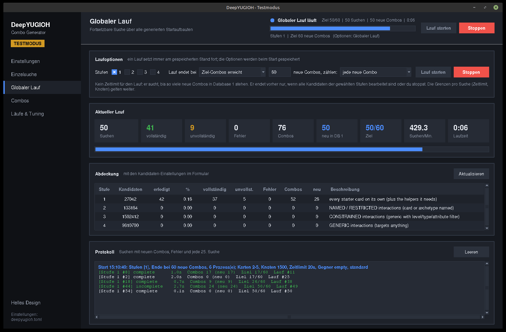
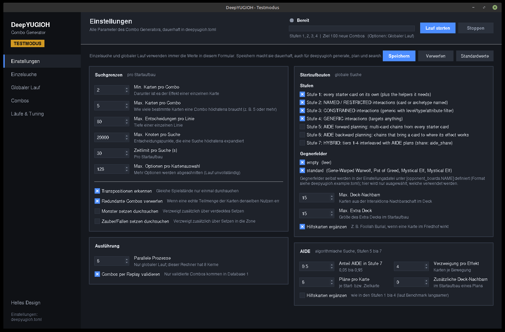
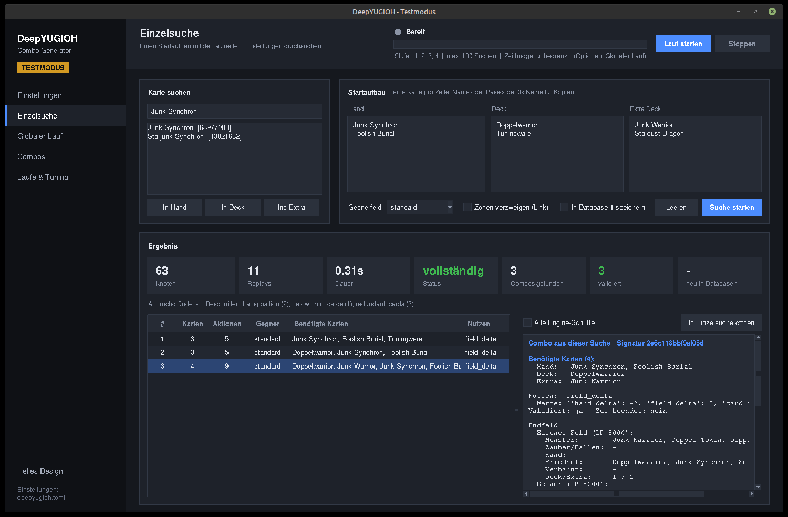
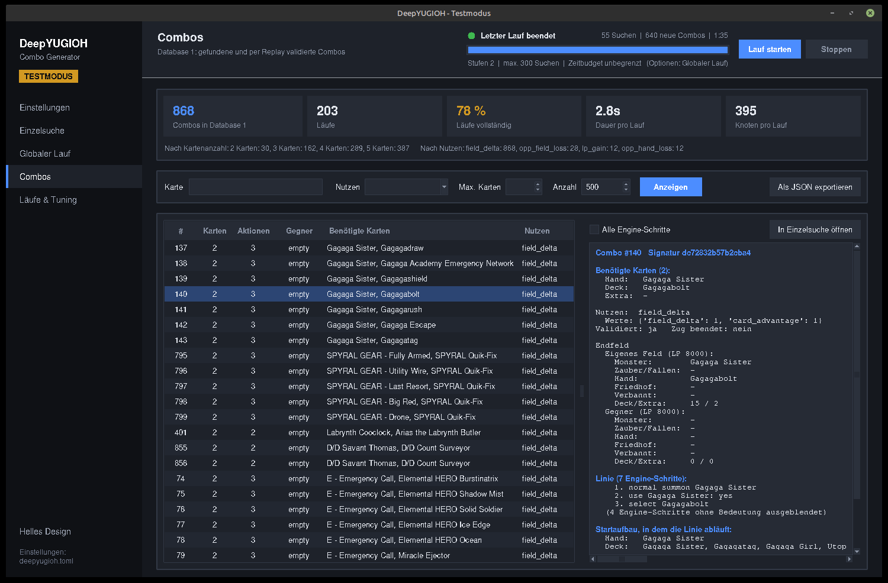
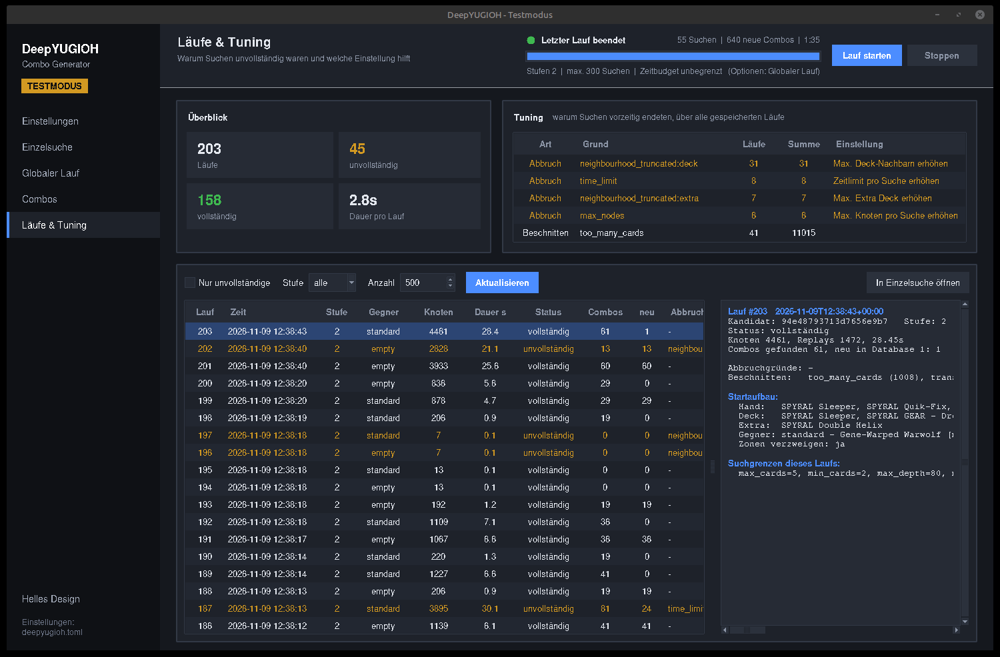

# DeepYUGIOH

Autonomes Forschungssystem für Yu-Gi-Oh!-Strategien. Phase 1 ist der **Combo Generator**: Er erzeugt aus dem gesamten Kartenpool Startaufbauten, lässt eine echte Spiel-Engine alle Combos darin suchen und speichert jede validierte Combo im Combo Repository (Database 1).



- **Ausführliche Softwaredokumentation** inklusive GUI und aller Einstellungen: [docs/software-dokumentation.html](docs/software-dokumentation.html) (im Browser öffnen)
- Vision und Architektur: [docs/konzept.md](docs/konzept.md)
- Definitionen, Startaufbauten, Suchgrenzen: [docs/combo-generator-spec.md](docs/combo-generator-spec.md)
- Schnittstellen des Generator-Moduls: [docs/schnittstellen.md](docs/schnittstellen.md)

## Einrichtung

Voraussetzungen: Linux, gcc/g++ (C++17), ninja, [uv](https://docs.astral.sh/uv/).

```bash
git submodule update --init --recursive   # Engine, Kartenskripte, Kartendatenbank
uv sync                                   # Python-Umgebung inkl. meson
scripts/build_core.sh                     # baut build/ocgcore/libocgcore.so
uv run deepyugioh import-cards            # Schritte 1-3: Karten, Effekte, Interaktionsgraph
uv run pytest                             # Tests gegen die echte Engine
```

## Benutzung

```bash
# globale Suche: Stufen, Abdeckung und Größe des Suchraums
uv run deepyugioh plan

# globale Suche starten bzw. fortsetzen (setzt am letzten Stand fort)
uv run deepyugioh generate --tiers 1 2 --workers 8 --time-budget 3600
uv run deepyugioh generate --tiers 1 2 3 --workers 8 --target 100 --benefit wins   # bis 100 neue Sieg-Combos
uv run deepyugioh generate --config deepyugioh.example.toml

# AIDE (optional): algorithmisch geplante Mehrkarten-Ketten, Stufen 5-7
uv run deepyugioh aide plan --card "Junk Converter"        # Pläne einer Karte ansehen
uv run deepyugioh generate --tiers 7 --time-budget 3600    # Hybrid: Stufen 1-4 im Wechsel mit AIDE
uv run deepyugioh benchmark --budget 300s                  # bisherige Suche vs. AIDE vs. Hybrid

# einen einzelnen Startaufbau durchsuchen
uv run deepyugioh search \
    --hand "Junk Synchron" "Foolish Burial" \
    --deck Doppelwarrior Tuningware \
    --extra "Junk Warrior" "Stardust Dragon" \
    --opponent standard --lines

# Database 1 abfragen
uv run deepyugioh combos --card "Junk Synchron" --lines
uv run deepyugioh combos --positive opp_field_loss
```

Karten können per englischem Namen oder Passcode angegeben werden.

Ohne `--config` verwenden `plan`, `generate` und `search` die dauerhaften Einstellungen aus `deepyugioh.toml` (lokal, nicht versioniert; fehlende Schlüssel = Standardwerte).

## Benutzeroberflächen

Jede Stufe des Systems bekommt eine eigene Test-GUI nach dem Vorbild der GUI des Combo Generators: gleiches Design, gleiche Bedienung, nur im Testmodus verfügbar. Aufbau und Gestaltungsregeln für weitere GUIs stehen in der [Softwaredokumentation, Abschnitt 10](docs/software-dokumentation.html#gui-technik).

### Phase 1: Combo Generator (Test-GUI)

Zum Feintuning des Generators und zum Auslesen der Ergebnisse gibt es eine grafische Oberfläche (tkinter, keine zusätzlichen Abhängigkeiten, dunkles und helles Design). Links liegt die Navigation, oben eine feste Kopfleiste mit **Lauf starten / Stoppen**, Fortschrittsbalken und Live-Kennzahlen des globalen Laufs; sie ist auf jeder Seite verfügbar. Die GUI startet nur bei aktivem Testmodus:

```bash
uv run deepyugioh testmode on      # Testmodus dauerhaft einschalten (steht in deepyugioh.toml)
uv run deepyugioh gui
uv run deepyugioh testmode off     # wieder ausschalten; DEEPYUGIOH_TEST_MODE=1/0 überschreibt die Datei
```

| Reiter | Inhalt |
|---|---|
| Einstellungen | Alle Suchgrenzen (Min./Max. Karten pro Combo, z. B. 5 oder mehr, Tiefe, Knoten, Zeitlimit, Optionen, Transpositionen, Setzen …), Stufen, Gegnerfelder, Nachbarschaft, Worker, Validierung. „Speichern“ schreibt sie dauerhaft nach `deepyugioh.toml`; die CLI nutzt sie dann ebenfalls. |
| Einzelsuche | Startaufbau mit Kartensuche zusammenstellen und mit den Formularwerten durchsuchen; Combos mit Endfeld und Linie. Speichern in Database 1 optional. |
| Globaler Lauf | Optionen des Laufs (Stufen, Ende bei N neuen Combos, z. B. 100 Sieg-Combos, oder nach Anzahl Suchen bzw. Zeitbudget), Kennzahlen live, Abdeckung pro Stufe und Protokoll. Gestartet und gestoppt wird auch über die Kopfleiste. |
| Combos (Database 1) | Filtern nach Karte, Nutzen und Kartenanzahl, Details, Läufe einer Combo, Export als JSON. |
| Läufe & Tuning | Alle gespeicherten Läufe, aufsummierte Abbruchgründe mit der jeweils zuständigen Einstellung; jeder Startaufbau lässt sich in der Einzelsuche mit neuen Grenzen erneut durchsuchen. |

<table>
  <tr>
    <td><br><sub>Einstellungen</sub></td>
    <td><br><sub>Einzelsuche</sub></td>
  </tr>
  <tr>
    <td><br><sub>Combos (Database 1)</sub></td>
    <td><br><sub>Läufe &amp; Tuning</sub></td>
  </tr>
</table>

Bedienung, alle Seiten und das Vorgehen beim Feintuning: [Softwaredokumentation, Abschnitt 7](docs/software-dokumentation.html#gui).

## Aufbau

| Pfad | Inhalt |
|---|---|
| [src/deepyugioh/contracts/](src/deepyugioh/contracts/) | Verträge zwischen den Modulen: Datentypen und Schnittstellen |
| [src/deepyugioh/cards/](src/deepyugioh/cards/) | Card Knowledge System: Import, Skriptanalyse, Interaktionsgraph (Schritte 1–3) |
| [src/deepyugioh/generator/](src/deepyugioh/generator/) | Combo Generator: Startaufbauten, Suche, Validierung, Jobs (Schritte 4–5); [aide/](src/deepyugioh/generator/aide/) plant Mehrkarten-Ketten aus Effektbeschreibungen (Stufen 5–7, optional) |
| [src/deepyugioh/engine/](src/deepyugioh/engine/) | ctypes-Anbindung an ygopro-core |
| [src/deepyugioh/repository/](src/deepyugioh/repository/) | Database 1 – Combo Repository (Schritt 6) |
| [src/deepyugioh/gui/](src/deepyugioh/gui/) | Test-GUI (nur im Testmodus) |
| [src/deepyugioh/settings.py](src/deepyugioh/settings.py) | Dauerhafte lokale Einstellungen und Testmodus |
| [third_party/](third_party/) | ygopro-core, CardScripts, BabelCDB (Submodules) |

Erzeugte Daten liegen in `data/` (nicht versioniert):
- `cards.sqlite`: Karten und Graph,
- `combos.sqlite`: Database 1,
- `generator.sqlite`: Fortschritt der globalen Suche,
- `aide.sqlite`: Kandidaten-Pool von AIDE (Pläne mit Status).

AIDE ist in der [Softwaredokumentation, Abschnitt 11](docs/software-dokumentation.html#aide) beschrieben, samt [Benchmark](docs/benchmarks/2026-11-09-aide.md). Bei gleicher Rechenzeit findet AIDE bisher weniger Combos als die Stufen 1–4, aber fast nur andere. Es bleibt deshalb optional, die Standardsuche ist unverändert.

## Lizenz

ygopro-core und die CardScripts stehen unter der AGPL-3.0. Weil dieses Projekt die Engine einbindet, gilt die AGPL auch für das Gesamtsystem, sobald es weitergegeben oder als Netzwerkdienst betrieben wird. Yu-Gi-Oh! ist eine Marke von Shueisha und Konami. Dieses Projekt ist damit nicht verbunden.
